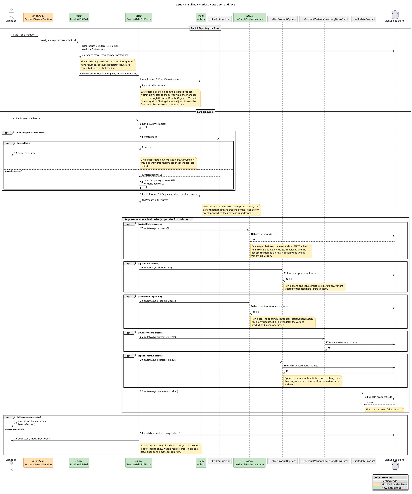

```puml
@startuml issue8-class-diagram
' Issue #8 / PR #79: full multi-step "Edit Product" flow in the admin dashboard.
' Colors: grey = existing code we had to understand, green = new, orange = modified.

title Issue #8 - Full Edit Product Flow: Class Diagram

skinparam classAttributeIconSize 0
skinparam shadowing false
skinparam defaultFontSize 12
skinparam noteBackgroundColor #FFF3C4
skinparam noteBorderColor #D9A400
skinparam class {
  BackgroundColor #EEEEEE
  BorderColor #777777
  BackgroundColor<<new>> #C8E6C9
  BorderColor<<new>> #2E7D32
  BackgroundColor<<modified>> #FFE0B2
  BorderColor<<modified>> #E65100
}

' ---------------------------------------------------------------
' EXISTING code (grey)
' ---------------------------------------------------------------
class RouteFocusModal <<component>> {
  + Form(form)
  --
  handleSuccess() closes modal
}

class ProductCreateVariantsSection <<component>> {
  options and variants builder
}

class "useExtendableForm" as UseExtendableForm <<hook>> {
  + defaultValues
  + schema : ProductCreateSchema
}

class "useProduct" as UseProduct <<hook>> {
  + product
  + isPending
}

class "useUpdateProduct" as UseUpdateProduct <<hook>> {
  + mutateAsync(AdminUpdateProduct)
}

class "useLinkProductOptions" as UseLinkProductOptions <<hook>> {
  + mutateAsync(AdminLinkProductOptions)
}

class "useProductVariantsInventoryItemsBatch" as UseInvBatch <<hook>> {
  + mutateAsync(inventory kit changes)
}

class "sdk.admin" as Sdk <<client>> {
  + product.update()
  + product.batchVariants()
  + product.linkOptions()
  + upload.create()
}

' ---------------------------------------------------------------
' MODIFIED code (orange)
' ---------------------------------------------------------------
class ProductGeneralSection <<modified>> {
  + render()
  --
  + "Edit Product" Button -> Link to "edit-all"
}

class ProductCreateDetailsForm <<modified>> {
  + form : UseFormReturn
  + mode : "create" | "edit"
}

class "get-route.map.tsx" as RouteMap <<modified>> {
  + route "edit-all" (lazy import)
}

' ---------------------------------------------------------------
' NEW code (green)
' ---------------------------------------------------------------
class ProductEditFull <<new>> {
  - id : string (route param)
  --
  + render()
  - loads product, store, regions, price prefs
}

class ProductEditFullForm <<new>> {
  - tab : Tab
  - form : UseFormReturn
  --
  + handleSubmit()
  + onNext()
  - getTabState(tab)
}

class "product-edit-full/utils.ts" as EditUtils <<new>> {
  + PRODUCT_EDIT_FULL_FIELDS
  + mapProductToFormValues(product)
  + mapVariantToFormValue(variant)
  + buildProductEditRequests(values, product, media)
}

class ProductEditRequests <<new>> {
  + variantDeletes?
  + optionsAdd?
  + variantsBatch?
  + inventoryItems?
  + optionsRemove?
  + product
}

class "mergeVariantCombinations" as MergeVariants <<new>> {
  + (variants, optionRecords) : Variant[]
}

class "useBatchProductVariants" as UseBatchVariants <<new>> {
  + mutateAsync(create / update / delete)
  --
  invalidates variants, product, inventory caches
}

' ---------------------------------------------------------------
' RELATIONSHIPS
' ---------------------------------------------------------------
ProductGeneralSection ..> RouteMap : navigates to\n"edit-all"
RouteMap ..> ProductEditFull : lazy loads
ProductEditFull *-- RouteFocusModal : wraps the flow\nin a modal
ProductEditFull --> ProductEditFullForm : renders once data\nhas loaded
ProductEditFull ..> UseProduct
ProductEditFull ..> EditUtils : PRODUCT_EDIT_FULL_FIELDS

ProductEditFullForm --> ProductCreateDetailsForm : reuses (mode="edit")
ProductCreateDetailsForm --> ProductCreateVariantsSection : forwards mode
ProductCreateVariantsSection ..> MergeVariants : merges regenerated\nvariant combinations
ProductEditFullForm ..> UseExtendableForm
ProductEditFullForm ..> EditUtils
EditUtils ..> ProductEditRequests : builds
ProductEditFullForm ..> ProductEditRequests : consumes

ProductEditFullForm ..> UseBatchVariants
ProductEditFullForm ..> UseLinkProductOptions
ProductEditFullForm ..> UseInvBatch
ProductEditFullForm ..> UseUpdateProduct
ProductEditFullForm ..> Sdk : upload.create()

UseBatchVariants ..> Sdk
UseLinkProductOptions ..> Sdk
UseInvBatch ..> Sdk
UseUpdateProduct ..> Sdk

' ---------------------------------------------------------------
' ANNOTATIONS
' ---------------------------------------------------------------
note top of ProductEditFull
  The form is not rendered until product, store, regions
  and price preferences have all loaded, because the
  form's default values are computed only once on the
  first render.
end note

note right of ProductEditFullForm
  Nothing is sent to the server until Save. The form is
  pre-filled from the stored product, and closing the
  modal triggers the unsaved-changes prompt instead of
  writing anything.

  Saving takes several requests because no single
  endpoint can update product fields, options, variants,
  prices and inventory kits together.
end note

note bottom of ProductEditFullForm
  Four separate mutation hooks, one per kind of request.
  If any request fails, handleSubmit stops, refetches
  the product and keeps the modal open for a retry.
end note

note right of ProductCreateDetailsForm
  Reuse instead of copy: the create flow's UI is
  reused for editing. A new optional "mode" prop
  (default "create") keeps the create flow unchanged.
end note

note left of UseBatchVariants
  New because the existing
  useUpdateProductVariantsBatch can only update. The
  edit flow also has to create and delete variants.
end note

note bottom of EditUtils
  Diffs the form values against the stored product and
  only emits requests for what actually changed. Each
  field of ProductEditRequests is optional so unchanged
  parts are skipped.
end note

note right of ProductEditRequests
  Field order is the order requests must be sent:
  deletes, optionsAdd, variantsBatch, inventoryItems,
  optionsRemove, product. The backend refuses to unlink
  an option value while a variant still uses it, and a
  batch runs its operations in parallel.
end note

note left of ProductGeneralSection
  The ellipsis menu keeps the quick single-section
  "Edit" drawer. The new button is a separate entry
  point to the full flow.
end note

' ---------------------------------------------------------------
' LEGEND
' ---------------------------------------------------------------
legend right
  |= Color |= Meaning |
  |<#EEEEEE>   | Existing code (studied during concept location) |
  |<#FFE0B2>   | Modified by this issue |
  |<#C8E6C9>   | New in this issue |
  Dashed arrow = dependency (uses)
  Solid arrow = association (holds a reference)
  Filled diamond = composition (owns)
endlegend

@enduml

```

<!-- Generated by SpecStory, Markdown v2.1.0 -->

# 2026-10-29 13:47:56Z

<!-- Claude Code Session 63563137-595f-470c-8406-1e8e630ce31e (2026-10-29 13:47:56Z) -->

_**User (2026-10-29 13:47:56Z)**_

I need to create a UML diagram for issue 8/PR 79. Do you have any ideas about how I should go about that? I have very little UML experience. What to create: One class diagram and one sequence diagram for one of your medium issues. The person who resolved the issue creates the diagrams. The diagrams should show code components and behavior relevant to your issue(s) --- more details below. Below we provide reference diagrams to guide this task. UML notation: Inheritance, composition, aggregation, dependency, and association are all valid and expected relationships for class diagrams (see the Glossary for definitions). For attributes and methods, show only those relevant to the issue; you do not need to show every member of every class. Each diagram should cover two things:

Relevant existing code you identified during concept location and impact analysis: the classes, components, or interactions already in the codebase that you needed to understand to implement your solution.
New and modified code that makes up your solution: the classes, methods, or interactions you added or changed.
Distinguish between existing and new/modified elements (for example, with a legend, color, or a label).

Annotations are required. Add brief notes directly on the diagram to explain key design decisions: why a specific relationship exists, why you structured a class a certain way, what an important method call is doing. Annotations are part of the deliverable and will be graded. Diagrams without annotations will not earn full credit. See the amber boxes in the reference diagrams below for examples of annotations.

---

_**Agent (claude-sonnet-5-5 2026-10-29 13:47:58Z)**_

I'll look at what PR 79 changed so the advice is specific to your code.

_**Agent (claude-sonnet-5-5 2026-10-29 13:48:01Z)**_

<tool-use data-tool-type="shell" data-tool-name="Bash"><details>
<summary>Tool use: **Bash**</summary>

`git log --oneline --first-parent -5 94b313ed0c && git diff --stat 94b313ed0c^1 94b313ed0c | tail -30`

```text
94b313ed0c Merge pull request #79 from CSCI-435-SE/feat/lefecko-issue-8-edit-product-full-flow
e25fade0cd Merge pull request #80 from CSCI-435-SE/feat/issue-66-keep-failed-executions
d9799e3081 Merge pull request #77 from CSCI-435-SE/feat/issue-59-enforce-product-id
f0f26237ca Merge pull request #78 from CSCI-435-SE/docs/sprint2-checkin-maali-ux
807b7bdd8d Merge pull request #76 from CSCI-435-SE/chore/add-sprint2-checkin
 .changeset/full-product-edit-flow.md               |   5 +
 .../src/dashboard-app/routes/get-route.map.tsx     |   7 +
 .../admin/dashboard/src/hooks/api/products.tsx     |  33 ++
 .../admin/dashboard/src/i18n/translations/en.json  |  11 +-
 .../product-create-details-variant-section.tsx     | 212 ++++++--
 .../product-create-details-form.tsx                |   9 +-
 .../routes/products/product-create/constants.ts    |   4 +
 .../products/product-create/merge-variants.ts      | 124 +++++
 .../product-general-section.tsx                    |  17 +-
 .../__tests__/merge-variants.spec.ts               | 116 ++++
 .../product-edit-full/__tests__/utils.spec.ts      | 299 +++++++++++
 .../components/product-edit-full-form/index.ts     |   1 +
 .../product-edit-full-form.tsx                     | 372 +++++++++++++
 .../src/routes/products/product-edit-full/index.ts |   1 +
 .../product-edit-full/product-edit-full.tsx        |  94 ++++
 .../src/routes/products/product-edit-full/utils.ts | 593 +++++++++++++++++++++
 16 files changed, 1848 insertions(+), 50 deletions(-)
```
</details></tool-use>

_**Agent (claude-sonnet-5-5 2026-10-29 13:48:05Z)**_

<tool-use data-tool-type="shell" data-tool-name="Bash"><details>
<summary>Tool use: **Bash**</summary>

`cd /Users/loganfecko/Desktop/CSCI_435/medusa/packages/admin/dashboard/src && cat ../../../../.changeset/full-product-edit-flow.md; git diff 94b313ed0c^1 94b313ed0c -- hooks/api/products.tsx dashboard-app/routes/get-route.map.tsx; cat routes/products/product-edit-full/product-edit-full.tsx; grep -n "^export\|^const\|^function\|^type" routes/products/product-edit-full/utils.ts routes/products/product-create/merge-variants.ts; grep -n "useForm\|useUpdate\|useBatch\|useCreate\|useDelete\|mutateAsync\|^export\|^const\|buildProductUpdatePayload\|buildVariant" routes/products/product-edit-full/components/product-edit-full-form/product-edit-full-form.tsx | head -60`

```text
---
"@medusajs/dashboard": patch
---

feat(dashboard): add an "Edit Product" button to the product detail page that opens a full multi-step edit flow mirroring the create product flow, pre-filled with the product's current values and saved only when confirmed at the end
diff --git a/packages/admin/dashboard/src/dashboard-app/routes/get-route.map.tsx b/packages/admin/dashboard/src/dashboard-app/routes/get-route.map.tsx
index cc678b9281..6d011053de 100644
--- a/packages/admin/dashboard/src/dashboard-app/routes/get-route.map.tsx
+++ b/packages/admin/dashboard/src/dashboard-app/routes/get-route.map.tsx
@@ -86,6 +86,13 @@ export function getRouteMap({
                           lazy: () =>
                             import("../../routes/products/product-edit"),
                         },
+                        {
+                          // Full multi-step edit flow (issue #8), opened by the
+                          // "Edit Product" button on the detail page.
+                          path: "edit-all",
+                          lazy: () =>
+                            import("../../routes/products/product-edit-full"),
+                        },
                         {
                           path: "edit-variant",
                           lazy: () =>
diff --git a/packages/admin/dashboard/src/hooks/api/products.tsx b/packages/admin/dashboard/src/hooks/api/products.tsx
index bb4719703c..bd47b2d67f 100644
--- a/packages/admin/dashboard/src/hooks/api/products.tsx
+++ b/packages/admin/dashboard/src/hooks/api/products.tsx
@@ -137,6 +137,39 @@ export const useUpdateProductVariantsBatch = (
   })
 }
 
+/**
+ * Batch create / update / delete of a product's variants in one request.
+ * Used by the full Edit Product flow, which can add and remove variants as
+ * well as update them (`useUpdateProductVariantsBatch` above only updates).
+ */
+export const useBatchProductVariants = (
+  productId: string,
+  options?: UseMutationOptions<
+    HttpTypes.AdminBatchProductVariantResponse,
+    FetchError,
+    HttpTypes.AdminBatchProductVariantRequest
+  >
+) => {
+  return useMutation({
+    mutationFn: (payload) =>
+      sdk.admin.product.batchVariants(productId, payload),
+    onSuccess: (data, variables, context) => {
+      queryClient.invalidateQueries({ queryKey: variantsQueryKeys.lists() })
+      queryClient.invalidateQueries({ queryKey: variantsQueryKeys.details() })
+      queryClient.invalidateQueries({
+        queryKey: productsQueryKeys.detail(productId),
+      })
+      // New variants with managed inventory create inventory items.
+      queryClient.invalidateQueries({
+        queryKey: inventoryItemsQueryKeys.lists(),
+      })
+
+      options?.onSuccess?.(data, variables, context)
+    },
+    ...options,
+  })
+}
+
 export const useProductVariantsInventoryItemsBatch = (
   productId: string,
   options?: UseMutationOptions<
import { useTranslation } from "react-i18next"
import { useParams } from "react-router-dom"

import { RouteFocusModal } from "../../../components/modals"
import { useRegions } from "../../../hooks/api"
import { usePricePreferences } from "../../../hooks/api/price-preferences"
import { useProduct } from "../../../hooks/api/products"
import { useStore } from "../../../hooks/api/store"
import { ProductEditFullForm } from "./components/product-edit-full-form"
import { PRODUCT_EDIT_FULL_FIELDS } from "./utils"

/**
 * Route component for `/products/:id/edit-all`: the full-screen "Edit Product"
 * flow opened from the product detail page.
 *
 * It only loads data and renders the modal shell; the form itself is not
 * rendered until everything it needs has arrived, because the form's default
 * values are computed once on first render.
 */
export const ProductEditFull = () => {
  const { id } = useParams()
  const { t } = useTranslation()

  const { product, isPending, isError, error } = useProduct(id!, {
    fields: PRODUCT_EDIT_FULL_FIELDS,
  })

  // Store: supplies the currencies shown as price columns.
  const {
    store,
    isPending: isStorePending,
    isError: isStoreError,
    error: storeError,
  } = useStore()

  // Regions and price preferences: needed for region-specific price columns.
  const {
    regions,
    isPending: isRegionsPending,
    isError: isRegionsError,
    error: regionsError,
  } = useRegions({ limit: 9999 })

  const {
    price_preferences,
    isPending: isPricePreferencesPending,
    isError: isPricePreferencesError,
    error: pricePreferencesError,
  } = usePricePreferences({ limit: 9999 })

  // Surface load failures through the route's error boundary, like the create
  // flow does.
  if (isError) {
    throw error
  }
  if (isStoreError) {
    throw storeError
  }
  if (isRegionsError) {
    throw regionsError
  }
  if (isPricePreferencesError) {
    throw pricePreferencesError
  }

  const ready =
    !!product &&
    !isPending &&
    !!store &&
    !isStorePending &&
    !!regions &&
    !isRegionsPending &&
    !!price_preferences &&
    !isPricePreferencesPending

  return (
    <RouteFocusModal>
      <RouteFocusModal.Title asChild>
        <span className="sr-only">{t("products.edit.full.title")}</span>
      </RouteFocusModal.Title>
      <RouteFocusModal.Description asChild>
        <span className="sr-only">{t("products.edit.full.description")}</span>
      </RouteFocusModal.Description>
      {ready && (
        <ProductEditFullForm
          product={product}
          store={store}
          regions={regions}
          pricePreferences={price_preferences}
        />
      )}
    </RouteFocusModal>
  )
}
routes/products/product-create/merge-variants.ts:3:type Variant = ProductCreateSchemaType["variants"][number]
routes/products/product-create/merge-variants.ts:4:type OptionRecord = Record<string, string>
routes/products/product-create/merge-variants.ts:10:const matches = (
routes/products/product-create/merge-variants.ts:49:export const mergeVariantCombinations = (
routes/products/product-edit-full/utils.ts:26:export const PRODUCT_EDIT_FULL_FIELDS = [
routes/products/product-edit-full/utils.ts:47:type EditableVariant = Omit<
routes/products/product-edit-full/utils.ts:69:type EditableProduct = Omit<HttpTypes.AdminProduct, "variants"> & {
routes/products/product-edit-full/utils.ts:78:const asEditable = (product: HttpTypes.AdminProduct) =>
routes/products/product-edit-full/utils.ts:87:export const getSortedVariants = (input: HttpTypes.AdminProduct) =>
routes/products/product-edit-full/utils.ts:98:const getMediaDefaults = (product: EditableProduct) => {
routes/products/product-edit-full/utils.ts:127:export const mapVariantToFormValue = (
routes/products/product-edit-full/utils.ts:186:export const mapProductToFormValues = (
routes/products/product-edit-full/utils.ts:243:const OPTION_VALUE_ID_PREFIX = "optval_"
routes/products/product-edit-full/utils.ts:244:const isOptionValueId = (value: string) =>
routes/products/product-edit-full/utils.ts:264:export type ProductEditRequests = {
routes/products/product-edit-full/utils.ts:277:const sameOptions = (a: Record<string, string>, b: Record<string, string>) =>
routes/products/product-edit-full/utils.ts:287:const buildOptionRequests = (
routes/products/product-edit-full/utils.ts:372:export const buildProductEditRequests = ({
routes/products/product-edit-full/utils.ts:568:const buildPricePayload = (
15:  useBatchProductVariants,
18:  useUpdateProduct,
48:export const ProductEditFullForm = ({
72:  const batchVariants = useBatchProductVariants(product.id)
75:  const updateProduct = useUpdateProduct(product.id)
177:        await batchVariants.mutateAsync({ delete: requests.variantDeletes })
183:        await linkOptions.mutateAsync(requests.optionsAdd)
190:        await batchVariants.mutateAsync(requests.variantsBatch)
196:        await updateInventoryItems.mutateAsync(requests.inventoryItems)
201:        await linkOptions.mutateAsync(requests.optionsRemove)
205:      await updateProduct.mutateAsync(requests.product)
```
</details></tool-use>

_**Agent (claude-sonnet-5-5 2026-10-29 13:48:08Z)**_

<tool-use data-tool-type="shell" data-tool-name="Bash"><details>
<summary>Tool use: **Bash**</summary>

`sed -n 40,260p routes/products/product-edit-full/components/product-edit-full-form/product-edit-full-form.tsx; sed -n 255,275p routes/products/product-edit-full/utils.ts; git diff 94b313ed0c^1 94b313ed0c -- routes/products/product-create/components/product-create-details-form/product-create-details-form.tsx routes/products/product-detail/components/product-general-section/product-general-section.tsx | head -90`

```text
type ProductEditFullFormProps = {
  product: HttpTypes.AdminProduct
  regions: HttpTypes.AdminRegion[]
  store: HttpTypes.AdminStore
  pricePreferences: HttpTypes.AdminPricePreference[]
}

export const ProductEditFullForm = ({
  product,
  regions,
  store,
  pricePreferences,
}: ProductEditFullFormProps) => {
  const [tab, setTab] = useState<Tab>(Tab.DETAILS)

  const { t } = useTranslation()
  const { handleSuccess } = useRouteModal()
  const { getFormConfigs } = useExtension()
  const direction = useDocumentDirection()

  // Pre-fill every field from the stored product (acceptance criterion 3).
  // `RouteFocusModal.Form` below watches this form's dirty state and shows the
  // "unsaved changes" prompt if the user tries to leave, so closing the modal
  // without saving never writes anything (criterion 6).
  const form = useExtendableForm({
    defaultValues: mapProductToFormValues(product),
    schema: ProductCreateSchema,
    configs: getFormConfigs("product", "create"),
  })

  // One mutation hook per kind of request the save may need to send.
  const batchVariants = useBatchProductVariants(product.id)
  const linkOptions = useLinkProductOptions(product.id)
  const updateInventoryItems = useProductVariantsInventoryItemsBatch(product.id)
  const updateProduct = useUpdateProduct(product.id)
  const isPending =
    batchVariants.isPending ||
    linkOptions.isPending ||
    updateInventoryItems.isPending ||
    updateProduct.isPending

  const regionsCurrencyMap = useMemo(
    () =>
      regions.reduce((acc, region) => {
        acc[region.id] = region.currency_code
        return acc
      }, {} as Record<string, string>),
    [regions]
  )

  // The inventory-kit tab only matters when at least one variant is a kit.
  const watchedVariants = useWatch({ control: form.control, name: "variants" })
  const showInventoryTab = useMemo(
    () => watchedVariants.some((v) => v.manage_inventory && v.inventory_kit),
    [watchedVariants]
  )

  const tabs = useMemo(
    () =>
      [
        Tab.DETAILS,
        Tab.ORGANIZE,
        Tab.VARIANTS,
        ...(showInventoryTab ? [Tab.INVENTORY] : []),
      ] as Tab[],
    [showInventoryTab]
  )
  const isLastTab = tab === tabs[tabs.length - 1]

  // Tabs before the current one are "completed", the current one is
  // "in-progress", the rest are "not-started".
  const getTabState = (value: Tab): ProgressStatus => {
    const current = tabs.indexOf(tab)
    const index = tabs.indexOf(value)

    if (index < current) {
      return "completed"
    }

    return index === current ? "in-progress" : "not-started"
  }

  /**
   * Save handler. Nothing is sent to the server until this runs (criterion 5).
   *
   * Saving is several requests because no single endpoint can update product
   * fields, options, variants, prices and inventory kits together. The order
   * (documented on `ProductEditRequests`) is dictated by backend rules: variants
   * that are being deleted go first, new options/values before the variants
   * that use them, and option values are only removed once nothing uses them.
   * The product's own fields go last. If a request fails we stop there instead
   * of carrying on in an inconsistent state.
   */
  const handleSubmit = form.handleSubmit(async (values) => {
    // Step 1: upload any newly added files. Entries that already have a URL
    // (existing images) have `file: null` and are left alone.
    const media = values.media ?? []
    const newFiles = media
      .map((m, index) => ({ file: m.file as File | null, index }))
      .filter((m) => !!m.file)

    let uploadedUrls: string[] = []

    if (newFiles.length) {
      try {
        const { files } = await sdk.admin.upload.create({
          files: newFiles.map((m) => m.file!),
        })
        uploadedUrls = files.map((f) => f.url)
      } catch (e) {
        // Unlike the create flow we stop here: carrying on would silently
        // drop the images the user just added.
        toast.error(t("products.media.failedToUpload"))
        return
      }
    }

    // Swap each new file's temporary preview URL for the uploaded URL.
    const resolvedMedia = media.map((m, index) => {
      const uploadIndex = newFiles.findIndex((f) => f.index === index)
      return uploadIndex > -1 ? { ...m, url: uploadedUrls[uploadIndex] } : m
    })

    // Step 2: work out what actually changed and build the payloads.
    const requests = buildProductEditRequests({
      values,
      product,
      media: resolvedMedia,
      regionsCurrencyMap,
    })

    try {
      // Step 3: delete variants the manager unchecked. Its own request, run
      // first: a batch runs create/update/delete in parallel, and the backend
      // refuses to unlink an option value while a variant still uses it.
      if (requests.variantDeletes) {
        await batchVariants.mutateAsync({ delete: requests.variantDeletes })
      }

      // Step 4: add new options and option values, so the variants created or
      // updated next can refer to them.
      if (requests.optionsAdd) {
        await linkOptions.mutateAsync(requests.optionsAdd)
      }

      // Step 5: create new variants and update changed ones (skipped if there
      // is nothing to do). Existing variants get their full options record
      // here when a new option was added.
      if (requests.variantsBatch) {
        await batchVariants.mutateAsync(requests.variantsBatch)
      }

      // Step 6: inventory kit links of existing variants (skipped if no kit
      // changed). New variants already carry their kit in step 5.
      if (requests.inventoryItems) {
        await updateInventoryItems.mutateAsync(requests.inventoryItems)
      }

      // Step 7: unlink option values nothing uses any more.
      if (requests.optionsRemove) {
        await linkOptions.mutateAsync(requests.optionsRemove)
      }

      // Step 8: the product itself, last.
      await updateProduct.mutateAsync(requests.product)
    } catch (e) {
      // Earlier requests may already have been saved, so refetch the product
      // to make sure the page reflects what is really stored, and keep the
      // modal open so the user can retry.
      await queryClient.invalidateQueries({
        queryKey: productsQueryKeys.detail(product.id),
      })

      toast.error(t("products.edit.full.errorToast"), {
        description: e instanceof Error ? e.message : undefined,
      })
      return
    }

    toast.success(
      t("products.edit.successToast", { title: values.title.trim() })
    )

    // No argument: close the modal and return to the product detail page.
    handleSuccess()
  })

  // Validate before moving on so errors surface on the tab where they occur.
  const onNext = async () => {
    if (!(await form.trigger())) {
      return
    }

    setTab(tabs[tabs.indexOf(tab) + 1])
  }

  return (
    <RouteFocusModal.Form form={form}>
      <KeyboundForm
        onKeyDown={(e) => {
          // Enter must not submit the form half-way through the flow.
          if (e.key !== "Enter") {
            return
          }

          if (
            e.target instanceof HTMLTextAreaElement &&
            !(e.metaKey || e.ctrlKey)
          ) {
            return
          }

          e.preventDefault()

          // Cmd/Ctrl+Enter advances, or saves on the last tab.
          if (e.metaKey || e.ctrlKey) {
            if (isLastTab) {
              handleSubmit()
            } else {
              e.stopPropagation()
 *     option values those variants used can be unlinked.
 *  2. `optionsAdd`: new options / values must exist before any variant uses them.
 *  3. `variantsBatch`: creates and updates (existing variants also get their
 *     full options record here when a new option was added).
 *  4. `inventoryItems`: kit changes for variants that already existed (new
 *     variants send their kit inside their create payload).
 *  5. `optionsRemove`: values are only unlinked once nothing uses them.
 *  6. `product`: the product's own fields, last.
 */
export type ProductEditRequests = {
  variantDeletes?: string[]
  optionsAdd?: HttpTypes.AdminLinkProductOptions
  variantsBatch?: Pick<
    HttpTypes.AdminBatchProductVariantRequest,
    "create" | "update"
  >
  inventoryItems?: HttpTypes.AdminBatchProductVariantInventoryItemRequest
  optionsRemove?: HttpTypes.AdminLinkProductOptions
  product: HttpTypes.AdminUpdateProduct
}

diff --git a/packages/admin/dashboard/src/routes/products/product-create/components/product-create-details-form/product-create-details-form.tsx b/packages/admin/dashboard/src/routes/products/product-create/components/product-create-details-form/product-create-details-form.tsx
index 7e119b85ce..b90b897beb 100644
--- a/packages/admin/dashboard/src/routes/products/product-create/components/product-create-details-form/product-create-details-form.tsx
+++ b/packages/admin/dashboard/src/routes/products/product-create/components/product-create-details-form/product-create-details-form.tsx
@@ -11,9 +11,14 @@ import { ProductCreateVariantsSection } from "./components/product-create-detail
 
 type ProductAttributesProps = {
   form: UseFormReturn<ProductCreateSchemaType>
+  /** Forwarded to the options/variants builder; "edit" is used by the full Edit Product flow. */
+  mode?: "create" | "edit"
 }
 
-export const ProductCreateDetailsForm = ({ form }: ProductAttributesProps) => {
+export const ProductCreateDetailsForm = ({
+  form,
+  mode = "create",
+}: ProductAttributesProps) => {
   const { getFormFields } = useExtension()
   const fields = getFormFields("product", "create", "general")
 
@@ -27,7 +32,7 @@ export const ProductCreateDetailsForm = ({ form }: ProductAttributesProps) => {
           <ProductCreateMediaSection form={form} />
         </div>
         <Divider />
-        <ProductCreateVariantsSection form={form} />
+        <ProductCreateVariantsSection form={form} mode={mode} />
       </div>
     </div>
   )
diff --git a/packages/admin/dashboard/src/routes/products/product-detail/components/product-general-section/product-general-section.tsx b/packages/admin/dashboard/src/routes/products/product-detail/components/product-general-section/product-general-section.tsx
index 17b276e2e4..d6461f3f20 100644
--- a/packages/admin/dashboard/src/routes/products/product-detail/components/product-general-section/product-general-section.tsx
+++ b/packages/admin/dashboard/src/routes/products/product-detail/components/product-general-section/product-general-section.tsx
@@ -1,8 +1,15 @@
 import { GlobeEurope, PencilSquare, Trash } from "@medusajs/icons"
 import { HttpTypes } from "@medusajs/types"
-import { Container, Heading, StatusBadge, toast, usePrompt } from "@medusajs/ui"
+import {
+  Button,
+  Container,
+  Heading,
+  StatusBadge,
+  toast,
+  usePrompt,
+} from "@medusajs/ui"
 import { useTranslation } from "react-i18next"
-import { useNavigate } from "react-router-dom"
+import { Link, useNavigate } from "react-router-dom"
 
 import { ActionMenu } from "../../../../../components/common/action-menu"
 import { SectionRow } from "../../../../../components/common/section"
@@ -76,6 +83,12 @@ export const ProductGeneralSection = ({
           <StatusBadge color={productStatusColor(product.status)}>
             {t(`products.productStatus.${product.status}`)}
           </StatusBadge>
+          {/* Entry point for the full edit flow (opens the `edit-all` child
+              route). The ellipsis menu below keeps the quick single-section
+              "Edit" drawer. */}
+          <Button size="small" variant="secondary" asChild>
+            <Link to="edit-all">{t("products.edit.full.button")}</Link>
+          </Button>
           <ActionMenu
             groups={[
               {
```
</details></tool-use>

_**Agent (claude-sonnet-5-5 2026-10-29 13:48:24Z)**_

Yes. I looked at the PR 79 diff, and it fits this assignment well. The work is a small set of collaborating pieces, and the save flow has a clear order of calls, which suits a sequence diagram.

## Basic UML you need

- **Class diagram:** boxes (name, attributes, methods) joined by lines. The lines you'll use are:
  - **Dependency** (dashed arrow): A uses B but doesn't hold on to it, e.g. a function calling a helper.
  - **Association** (plain arrow): A holds a reference to B.
  - **Composition** (filled diamond): A owns B, and B can't exist without A.
  - **Aggregation** (hollow diamond): A contains B, but B can exist on its own.
  - **Inheritance** (hollow triangle): A is a kind of B.
- **Sequence diagram:** participants across the top, with time running downward. Arrows are calls, dashed arrows are returns. Use `alt` boxes for if/else and `opt` boxes for "only if needed".

Your code is React functions, not classes. That's fine. Draw each component, hook or utility module as a class box and mark it with a stereotype such as `<<component>>`, `<<hook>>` or `<<utility>>`.

## Class diagram

**Existing code (grey):**
- `ProductGeneralSection`, the detail page the button is added to.
- `ProductCreateDetailsForm` and `ProductCreateVariantsSection`, which are reused.
- `useProduct`, `useUpdateProduct`, `useLinkProductOptions`, `useProductVariantsInventoryItemsBatch`, and the `sdk.admin.*` client.
- `RouteFocusModal` and `useExtendableForm`.

**New or modified code (colored):**
- New:
  - `ProductEditFull` (route, loads data)
  - `ProductEditFullForm` (tabs and save handler)
  - `utils.ts` (`mapProductToFormValues`, `buildProductEditRequests`, `ProductEditRequests`)
  - `mergeVariantCombinations`
  - `useBatchProductVariants`
  - the `edit-all` route entry in `get-route.map.tsx`
- Modified:
  - `ProductGeneralSection` (new "Edit Product" button)
  - `ProductCreateDetailsForm` and `ProductCreateVariantsSection` (new `mode: "create" | "edit"` prop)

**Relationships to draw:**
- `ProductGeneralSection` → `ProductEditFull`: dependency, via navigation to `edit-all`.
- `ProductEditFull` → `ProductEditFullForm`: association.
- `ProductEditFullForm` → `ProductCreateDetailsForm`: association, reuse.
- `ProductEditFullForm` → `utils`: dependency.
- `ProductEditFullForm` → the four mutation hooks: dependency.
- The hooks → `sdk`: dependency.
- `ProductEditFull` → `RouteFocusModal`: composition, since the modal wraps the form.

## Sequence diagram

Use the save flow in `handleSubmit`. The participants are Manager, `ProductEditFullForm`, `sdk.upload`, `buildProductEditRequests`, `useBatchProductVariants`, `useLinkProductOptions`, `useUpdateProduct` and the Backend.

The messages, in order:
1. The manager clicks Save.
2. Upload new files, but only if there are any (`opt`).
3. `buildProductEditRequests` diffs the form against the stored product and returns a `ProductEditRequests` object.
4. Delete variants (`opt`).
5. Add options (`opt`).
6. Batch create and update variants (`opt`).
7. Update inventory kits (`opt`).
8. Remove option values (`opt`).
9. Update the product.
10. An `alt` for the outcome. On success, show a toast and close the modal. On failure, refetch the product, show an error toast and keep the modal open.

You could add a short second flow for opening the page: the button click, route load, `useProduct` and the others, then `mapProductToFormValues`.

## Annotations

Put these in amber note boxes on the diagrams. All of them come from your code comments:
- The form isn't rendered until all data has loaded, because the default values are computed once on first render.
- No request is sent until Save, so closing the modal discards everything.
- Saving takes several requests because no single endpoint can update everything.
- Deletes run first and option removal runs last, because the backend refuses to unlink an option value that a variant still uses.
- A batch runs its create, update and delete in parallel, which is why deletes get their own request.
- `mode` lets the create UI be reused instead of copied.
- `useBatchProductVariants` is new because the existing hook only updates variants.
- On a failed upload, the flow stops instead of silently dropping images.

## Tooling

I'd use **PlantUML** or **Mermaid**, since you write text and get a diagram. Both support notes and color, and diagrams-as-code are easy to revise.
- PlantUML: paste the code into plantuml.com. It has the best support for notes, `<<stereotypes>>` and colors.
- draw.io: fully manual and fine, but slower to edit.

For the existing vs. new legend, use grey for existing, green for new and orange for modified. Add a small legend box on each diagram.

## Next step

I can draft the PlantUML source for both diagrams, with the colors, legend and annotations already in place. You could then tweak it and export the images. Want me to do that? If you'd rather keep the diagrams to one flow, I'd suggest the save flow, since it's the most interesting behavior.

result: Explained UML basics and gave a concrete plan for the PR 79 class and sequence diagrams, based on the code in the merged diff. The plan covers classes, relationships, call order, annotations and tooling. No files were changed.

---

_**User (2026-10-29 13:50:53Z)**_

sure let's do plantUML. Remember that I need a class and a sequence diagram

---

_**Agent (claude-sonnet-5-5 2026-10-29 13:50:57Z)**_

I'll write both files outside the repo so they don't mix with your branch changes, then try to render them.

_**Agent (claude-sonnet-5-5 2026-10-29 13:51:26Z)**_

<tool-use data-tool-type="shell" data-tool-name="Bash"><details>
<summary>Tool use: **Bash**</summary>

`mkdir -p /Users/loganfecko/Desktop/CSCI_435/issue-8-diagrams && which plantuml java dot; ls /opt/homebrew/bin | grep -i plantuml`

```text
plantuml not found
/usr/bin/java
dot not found
```
</details></tool-use>

_**Agent (claude-sonnet-5-5 2026-10-29 13:51:27Z)**_

<tool-use data-tool-type="write" data-tool-name="Write"><details>
<summary>Tool use: **Write**</summary>



```text
File created successfully at: /Users/loganfecko/Desktop/CSCI_435/issue-8-diagrams/class-diagram.puml (file state is current in your context — no need to Read it back)
```
</details></tool-use>

_**Agent (claude-sonnet-5-5 2026-10-29 13:51:27Z)**_

<tool-use data-tool-type="write" data-tool-name="Write"><details>
<summary>Tool use: **Write**</summary>



```text
File created successfully at: /Users/loganfecko/Desktop/CSCI_435/issue-8-diagrams/sequence-diagram.puml (file state is current in your context — no need to Read it back)
```
</details></tool-use>

_**Agent (claude-sonnet-5-5 2026-10-29 13:51:38Z)**_

I wrote both PlantUML files, but I haven't rendered or syntax-checked them. This machine has no `plantuml` or Graphviz installed. A syntax error is possible, so paste each one into plantuml.com and tell me if it complains.

The files are in `/Users/loganfecko/Desktop/CSCI_435/issue-8-diagrams/`, outside the repo so they don't touch your branch:
- `class-diagram.puml`
- `sequence-diagram.puml`

## How to render them
1. Go to plantuml.com/plantuml, paste one file's contents and export a PNG or SVG.
2. Or install the tools with `brew install plantuml` and run `plantuml -tpng *.puml` in that folder.

## Class diagram: where and what
- **Grey (existing):** `RouteFocusModal`, `ProductCreateVariantsSection`, `useExtendableForm`, `useProduct`, `useUpdateProduct`, `useLinkProductOptions`, `useProductVariantsInventoryItemsBatch` and `sdk.admin`. These are what you had to understand during concept location.
- **Orange (modified):**
  - `ProductGeneralSection`, which gets the new button.
  - `ProductCreateDetailsForm`, which gets the new `mode` prop.
  - `get-route.map.tsx`, which gets the `edit-all` route.
- **Green (new):** `ProductEditFull`, `ProductEditFullForm`, `utils.ts`, `ProductEditRequests`, `mergeVariantCombinations` and `useBatchProductVariants`.
- **Relationships:** dependency (dashed), association (solid) and composition (`ProductEditFull` owns the `RouteFocusModal`).
- **Annotations (amber):** eight notes. They cover why the form waits for the data, why nothing is saved until Save, why there are several requests, why `mode` is a prop, why the batch hook is new, why the request order is fixed, how the diffing works, and why the old edit drawer stays.

## Sequence diagram: where and what
- **Part 1, opening:** the button click, the route loading its four queries, `mapProductToFormValues` pre-filling the form, and a note that nothing is written to the server.
- **Part 2, saving:**
  - An optional upload step, with an `alt` for failure, which stops the flow.
  - `buildProductEditRequests`.
  - A group of six `opt` requests in the real order: delete variants, add options, create/update variants, inventory kits, remove options, update the product.
  - A final `alt` for success versus failure. On failure the product is refetched and the modal stays open.
- **Annotations:** about ten notes, mostly explaining the ordering rules.
- **Legend:** both diagrams use the same color legend, so existing vs. new vs. modified is clear.

## Things to check before you submit
- Whether `ProductCreateVariantsSection` calls `mergeVariantCombinations`. I inferred that link from the PR's file list and didn't read that file. Open `product-create-details-variant-section.tsx` and confirm, or delete that arrow.
- The class and member names I show come from the diff, but I didn't verify every method signature. Adjust anything your grader might compare against the code.
- If a diagram feels too crowded, remove some of the hook-to-`sdk` arrows in the class diagram. The notes matter more than completeness.

If PlantUML gives errors or the layout is messy, send me the error or a screenshot and I'll fix it.

result: Created the class and sequence diagrams for issue 8 / PR 79 as PlantUML files in /Users/loganfecko/Desktop/CSCI_435/issue-8-diagrams/. They include color-coded existing/new/modified elements, a legend and annotations. I haven't rendered them because PlantUML isn't installed here.

---

_**User (2026-10-29 13:59:56Z)**_

In the class UML, what is upload.create() doing on an island by itself

---

_**Agent (claude-sonnet-5-5 2026-10-29 14:00:03Z)**_

Most likely you're looking at the arrow label. `upload.create()` is a label I put on the dashed arrow from `ProductEditFullForm` to `sdk.admin`, and PlantUML can render a label detached from its line. I can't see your render, so I'm guessing. The label isn't meant to stand alone.

The point behind it is real, though. Upload is the one backend call the form makes directly through the SDK. The other four go through mutation hooks. That's why it's step 2 of `handleSubmit`. I'll make it an explicit class, matching the `sdk.admin.upload` participant in the sequence diagram, instead of a floating label.

_**Agent (claude-sonnet-5-5 2026-10-29 14:00:07Z)**_

<tool-use data-tool-type="write" data-tool-name="Edit"><details>
<summary>Tool use: **Edit**</summary>

```text
The file /Users/loganfecko/Desktop/CSCI_435/issue-8-diagrams/class-diagram.puml has been updated successfully. (file state is current in your context — no need to Read it back)
```
</details></tool-use>

_**Agent (claude-sonnet-5-5 2026-10-29 14:00:07Z)**_

<tool-use data-tool-type="write" data-tool-name="Edit"><details>
<summary>Tool use: **Edit**</summary>

```text
The file /Users/loganfecko/Desktop/CSCI_435/issue-8-diagrams/class-diagram.puml has been updated successfully. (file state is current in your context — no need to Read it back)
```
</details></tool-use>

_**Agent (claude-sonnet-5-5 2026-10-29 14:00:07Z)**_

<tool-use data-tool-type="write" data-tool-name="Edit"><details>
<summary>Tool use: **Edit**</summary>

```text
The file /Users/loganfecko/Desktop/CSCI_435/issue-8-diagrams/class-diagram.puml has been updated successfully. (file state is current in your context — no need to Read it back)
```
</details></tool-use>

_**Agent (claude-sonnet-5-5 2026-10-29 14:00:09Z)**_

I changed `class-diagram.puml` as follows:
- **`sdk.admin.upload`:** it's now its own grey (existing) class with a `create(files)` method. It no longer sits as a member of `sdk.admin`.
- **Connection:** a dashed dependency arrow runs from `ProductEditFullForm` to it, labeled "uploads new images (called directly, no hook)". It should be attached to a real line now.
- **Annotation:** I added a note explaining why upload is different. It's the only call made directly, it runs first, and a failure stops the save.

I still haven't rendered it. If it still looks disconnected after you re-paste it into plantuml.com, tell me which element is floating.

result: Explained that `upload.create()` was a floating arrow label, and fixed it in class-diagram.puml by making `sdk.admin.upload` its own connected class with an explanatory note. The change isn't rendered or verified.

---

_**User (2026-10-29 14:02:31Z)**_

I'm getting a 400 error, request header is too large

---

_**Agent (claude-sonnet-5-5 2026-10-29 14:02:39Z)**_

That 400 comes from plantuml.com's web editor. It sends the whole diagram in the URL, and the notes make these files too big for that. The diagram itself is fine. You have two ways around it.

**Option 1: render locally (recommended).** Type this in the prompt so it runs in this session:

```
! brew install plantuml
```

Homebrew should also install Graphviz as a dependency, which class diagrams need. Then run:

```
! cd /Users/loganfecko/Desktop/CSCI_435/issue-8-diagrams && plantuml -tpng -Sdpi=200 *.puml
```

This writes `class-diagram.png` and `sequence-diagram.png` next to the source files. The higher DPI keeps the small annotation text legible. If you'd like vector output, use `-tsvg`.

If you run it and it reports a syntax error, paste the message to me and I'll fix the file. I can also run these commands myself if you tell me to go ahead.

**Option 2: an editor extension.**
- Install the "PlantUML" extension in VS Code. It also needs Java, which you have, and Graphviz (`brew install graphviz`).
- Open a `.puml` file and press Option+D to preview. Use the extension's export command to save images.

**Option 3: a different web renderer.**
- The PlantText site (planttext.com) posts the diagram instead of putting it in the URL. It may handle the size, but I haven't tested it.

I'd go with Option 1, since it also gives you a real syntax check of both files.

result: Diagnosed the 400 error as plantuml.com's URL-based editor rejecting the large diagrams, and gave local-render steps (brew install plantuml, then plantuml -tpng). Nothing has been rendered yet, so the diagrams are still unverified.

---

_**User (2026-10-29 14:07:32Z)**_

The PNG files rendered but only like half, part is cut off

---

_**Agent (claude-sonnet-5-5 2026-10-29 14:07:38Z)**_

That's my fault. PlantUML caps image dimensions at 4096 px by default and crops anything beyond that. These diagrams are large, and the `-Sdpi=200` I suggested made them bigger still. Lift the cap:

```
! cd /Users/loganfecko/Desktop/CSCI_435/issue-8-diagrams && PLANTUML_LIMIT_SIZE=16384 plantuml -tpng -Sdpi=150 *.puml
```

If it's still cut off, raise the limit to 32768. Very large PNGs can be heavy, so if the file gets unwieldy, use SVG instead. SVG has no pixel cap and stays sharp when zoomed:

```
! cd /Users/loganfecko/Desktop/CSCI_435/issue-8-diagrams && plantuml -tsvg *.puml
```

You can open the `.svg` in a browser, and most documents can take it. If your submission needs a PNG or PDF, open the SVG in Chrome and use Print then Save as PDF, or take a screenshot.

If the class diagram still looks too wide after this, I can reduce the width in the `.puml` itself. For example, I could add `left to right direction`, or shorten the notes so the layout is more compact. Send me a screenshot if you want me to do that.

result: Explained the cropped PNGs as PlantUML's default 4096 px size cap and gave commands to lift it (PLANTUML_LIMIT_SIZE) or switch to SVG output. I haven't verified that the re-rendered files are complete.

---

_**User (2026-10-29 14:28:34Z)**_

Is an mmd and a puml file format the same?

---

_**Agent (claude-sonnet-5-5 2026-10-29 14:28:39Z)**_

No. They're different formats for different tools.

- **`.puml`** is PlantUML. It needs Java and Graphviz to render, and it's what we've been using. Its syntax starts with `@startuml` and ends with `@enduml`, and it has the richer features, such as styled notes, stereotypes, colors and legends.
- **`.mmd`** is Mermaid. It's a JavaScript-based tool. Its syntax starts with something like `classDiagram` or `sequenceDiagram`, and it's what GitHub and many Markdown viewers render natively.

The content isn't interchangeable. Pasting one into the other's renderer will give syntax errors. Converting means rewriting the diagram, and some things we use, like the colored stereotypes, the legend and the placement of notes, don't carry over well.

Is there a reason you're asking? If your course asked for Mermaid specifically, or you wanted something GitHub could render in the repo, I can rewrite the diagrams. Otherwise, I'd stay with the `.puml` files and submit the exported images.

result: Explained that .mmd (Mermaid) and .puml (PlantUML) are different, non-interchangeable formats, and offered to convert the diagrams if Mermaid is needed.

---

_**User (2026-10-29 14:28:53Z)**_

But they're both to generate uml diagrams?

---

_**Agent (claude-sonnet-5-5 2026-10-29 14:28:57Z)**_

Yes, they do the same job. Both turn text into a UML diagram. They are two separate tools that each read their own syntax, so a file written for one won't render in the other.

Compare it to Python and JavaScript. Both are programming languages, but you can't run one in the other's interpreter.

Here is the same tiny sequence diagram in each:

```
PlantUML (.puml)          Mermaid (.mmd)
@startuml                 sequenceDiagram
Manager -> Form : Save        Manager->>Form: Save
@enduml
```

The difference is in the details: the arrow style, the start and end markers, and how notes, colors and legends work.

For your assignment, use whichever tool you can export a good image from. The grader only sees the rendered diagram, so you're fine with the `.puml` files and the PNG or SVG you export.

If you'd rather use Mermaid, say so and I'll rewrite both diagrams. Expect a plainer look for the colors and legend.

result: Confirmed that PlantUML and Mermaid both generate UML diagrams from text but use incompatible syntaxes, and said the existing .puml files are fine for the assignment.

---

_**User (2026-10-29 14:29:21Z)**_

Can you make sure that I'm up to date with the main branch?

---

_**Agent (claude-sonnet-5-5 2026-10-29 14:29:23Z)**_

I'll fetch the remote and compare your branch against `develop`, without changing anything.

_**Agent (claude-sonnet-5-5 2026-10-29 14:29:27Z)**_

<tool-use data-tool-type="shell" data-tool-name="Bash"><details>
<summary>Tool use: **Bash**</summary>

`cd /Users/loganfecko/Desktop/CSCI_435/medusa && git branch --show-current && git remote -v | head -2 && git fetch origin 2>&1 | tail -3; echo ---; git rev-list --left-right --count origin/develop...HEAD; echo ---; git log --oneline HEAD..origin/develop | head -15; echo ---; git status -sb | head -3`

```text
feat/issue-67-configure-workflow-expiration
origin	https://github.com/CSCI-435-SE/medusa.git (fetch)
origin	https://github.com/CSCI-435-SE/medusa.git (push)
   94b313ed0c..55646f5b90  develop    -> origin/develop
   795a9808b7..b7676061a3  feat/issue-17-csv-export-customers -> origin/feat/issue-17-csv-export-customers
 * [new branch]            feat/issue-71-72-shipment-tracking -> origin/feat/issue-71-72-shipment-tracking
---
29	0
---
55646f5b90 Merge pull request #83 from CSCI-435-SE/fix/issue-58-cart-inventory-errors
af24da0932 Merge pull request #85 from CSCI-435-SE/feat/issue-63-duplicate-promotion
c304897bb6 Merge remote-tracking branch 'origin/develop' into feat/issue-63-duplicate-promotion
f935b95795 Merge pull request #86 from CSCI-435-SE/feat/issue-67-configure-workflow-expiration
f962095716 Merge pull request #84 from CSCI-435-SE/feat/issue-41-promotion-csv-import
54dc060a4f Merge pull request #82 from CSCI-435-SE/feat/lefecko-issue-65-duplicate-product
ac6c908179 Fix merged route map and add menu tests
e9a5a17ab6 Merge branch 'develop' into feat/lefecko-issue-65-duplicate-product
fca25a84bd chore: add changeset for promotion duplicate
4ffda95c61 Add promotion duplicate action to the dashboard
6b009caab1 Add promotion duplicate to the js sdk
0e5fb2b99d Add promotion duplicate route
22bac28bb3 Add duplicate promotion workflow
8ea13fc1d4 Add tests for promotion duplicate in the dashboard
d6e0db7276 Add tests for promotion duplicate route
---
## feat/issue-67-configure-workflow-expiration...origin/feat/issue-67-configure-workflow-expiration
 M .devcontainer/devcontainer-lock.json
 M packages/admin/dashboard/vite.config.mts
```
</details></tool-use>

_**Agent (claude-sonnet-5-5 2026-10-29 14:29:31Z)**_

You're not up to date. Your current branch, `feat/issue-67-configure-workflow-expiration`, is 29 commits behind `origin/develop` and has 0 commits that `develop` lacks. I fetched, which only downloads and changes none of your files.

Since your branch has no commits `develop` is missing, it's a clean fast-forward. It looks like the issue 67 work already merged as PR #86 and is in `develop`.

`develop` has picked up these PRs since your branch point:
- #83: cart inventory errors
- #85: duplicate promotion
- #86: workflow expiration (issue 67)
- #84: promotion CSV import
- #82: duplicate product

You have uncommitted changes in `.devcontainer/devcontainer-lock.json` and `packages/admin/dashboard/vite.config.mts`, plus some untracked files. A fast-forward would leave them alone unless the incoming commits touch those same two files.

I haven't switched branches or merged, because you didn't ask for that. Two ways to catch up:
- **Stay on this branch:** `git merge --ff-only origin/develop`.
- **Switch to `develop`:** `git checkout develop && git pull`. Since issue 67 is already merged, this is the cleaner choice if you're starting new work. Git will stop you if your two modified files conflict, so tell me if you want me to check that first.

Do you want me to do either of those?

result: Fetched origin and found your branch is 29 commits behind origin/develop with nothing unique, so it can fast-forward. I haven't made any changes yet and can run the merge or checkout if you want.

---

_**User (2026-10-29 14:29:47Z)**_

fast forward please

---

_**Agent (claude-sonnet-5-5 2026-10-29 14:29:50Z)**_

<tool-use data-tool-type="shell" data-tool-name="Bash"><details>
<summary>Tool use: **Bash**</summary>

`git merge --ff-only origin/develop 2>&1 | tail -8; echo ---; git rev-list --left-right --count origin/develop...HEAD; git status -sb | head -6`

```text
 create mode 100644 packages/core/core-flows/src/promotion/helpers/__tests__/import-promotions.spec.ts
 create mode 100644 packages/core/core-flows/src/promotion/helpers/import-promotions.ts
 create mode 100644 packages/core/core-flows/src/promotion/steps/validate-promotion-import.ts
 create mode 100644 packages/core/core-flows/src/promotion/workflows/duplicate-promotion.ts
 create mode 100644 packages/core/core-flows/src/promotion/workflows/import-promotions.ts
 create mode 100644 packages/medusa/src/api/admin/products/[id]/duplicate/route.ts
 create mode 100644 packages/medusa/src/api/admin/promotions/[id]/duplicate/route.ts
 create mode 100644 packages/medusa/src/api/admin/promotions/import/route.ts
---
0	0
## feat/issue-67-configure-workflow-expiration...origin/feat/issue-67-configure-workflow-expiration [ahead 29]
 M .devcontainer/devcontainer-lock.json
 M packages/admin/dashboard/vite.config.mts
?? ".changeset/sales-summary-time-interval 2.md"
?? .specstory/
?? my-store/
```
</details></tool-use>

_**Agent (claude-sonnet-5-5 2026-10-29 14:29:54Z)**_

The fast-forward worked. Your branch, `feat/issue-67-configure-workflow-expiration`, is now level with `origin/develop` (0 behind, 0 ahead). Your uncommitted changes to `devcontainer-lock.json` and `vite.config.mts` and your untracked files are unchanged.

Git also shows the branch as "ahead 29" of its own remote copy, `origin/feat/issue-67-configure-workflow-expiration`. That only means your local branch has commits the old remote branch doesn't. I haven't pushed anything. Since issue 67 is already merged, you probably don't need to push this branch. For new work, I'd branch from `develop` instead.

If you want to keep working on issue 8, nothing else is needed. The diagram files are in `/Users/loganfecko/Desktop/CSCI_435/issue-8-diagrams/`, outside the repo.

result: Fast-forwarded feat/issue-67-configure-workflow-expiration to origin/develop (29 commits). The branch now matches origin/develop, and your uncommitted changes are intact. Nothing was pushed.

---

_**User (2026-10-29 14:33:16Z)**_

I just created a new folder in docs/sprint2/diagrams. Can you fill in the md file with this info: 

<pasted_content id="85c1">
# Issue #<N> -- <issue title>

## Class Diagram


## Sequence Diagram


## Q&A

**Class diagram:**

1. Among all the classes shown in the diagram, which 1--2 are most central to understanding the codebase and solving the issue? Explain what role each one plays.

2. What is the most significant relationship shown in the diagram? Explain what it represents in the system and why it matters for understanding the solution.

3. Looking back at your implementation, is there anything in this design you would change, and why?

**Sequence diagram:**

1. What user action or system event starts the sequence, and what is the expected outcome when it completes successfully?

2. Identify the 2--3 most important steps in the sequence. For each one, describe what is happening and note whether it involves existing code or new/modified code from your solution.

3. What error cases or alternative paths are not shown in the diagram, and why did you leave them out?

**Cross-cutting:**

4. If you used AI to create or check any part of the diagrams, describe what it produced, what you verified against the actual code, and what you had to correct or add. If AI was not used, write "N/A."
</pasted_content id="85c1">


---

_**Agent (claude-sonnet-5-5 2026-10-29 14:33:19Z)**_

<tool-use data-tool-type="shell" data-tool-name="Bash"><details>
<summary>Tool use: **Bash**</summary>

`ls -la docs/sprint2/diagrams docs/sprint2 2>&1; git status --short docs | head; for f in docs/sprint2/diagrams/*.md; do echo "== $f"; cat "$f"; done; git log --oneline -3 -- docs/sprint2`

```text
docs/sprint2:
total 0
drwxr-xr-x  5 loganfecko  staff  160 Oct 29 10:30 .
drwxr-xr-x  7 loganfecko  staff  224 Oct 28 17:54 ..
-rw-r--r--  1 loganfecko  staff    0 Sep  2 19:35 .gitkeep
drwxr-xr-x@ 6 loganfecko  staff  192 Oct 28 17:54 checkin
drwxr-xr-x@ 7 loganfecko  staff  224 Oct 29 10:32 diagrams

docs/sprint2/diagrams:
total 2456
drwxr-xr-x@ 7 loganfecko  staff     224 Oct 29 10:32 .
drwxr-xr-x  5 loganfecko  staff     160 Oct 29 10:30 ..
-rw-r--r--@ 1 loganfecko  staff  629546 Oct 29 10:31 8-lefecko-class.png
-rw-r--r--@ 1 loganfecko  staff    7130 Oct 29 10:31 8-lefecko-class.puml
-rw-r--r--@ 1 loganfecko  staff  607083 Oct 29 10:31 8-lefecko-sequence.png
-rw-r--r--@ 1 loganfecko  staff    5230 Oct 29 10:31 8-lefecko-sequence.puml
-rw-r--r--@ 1 loganfecko  staff       0 Oct 29 10:32 8-lefecko.md
?? docs/sprint2/diagrams/
== docs/sprint2/diagrams/8-lefecko.md
b311d1366d docs: add sprint2 mid-sprint checkin for maali-ux
8bdb7f8124 Add mid sprint checkin
0161aa2cc5 Merge pull request #75 from CSCI-435-SE/chore/lefecko-mid-sprint-check-in
```
</details></tool-use>

_**Agent (claude-sonnet-5-5 2026-10-29 14:33:24Z)**_

<tool-use data-tool-type="shell" data-tool-name="Bash"><details>
<summary>Tool use: **Bash**</summary>

`gh issue view 8 --json title,body 2>&1 | head -40; diff <(cat docs/sprint2/diagrams/8-lefecko-class.puml) ../issue-8-diagrams/class-diagram.puml | head -20; echo; ls docs/sprint2/checkin | head`

```text
{"body":"## User Story\nAs a store manager, I want to click an \"Edit Product\" button that opens a complete editing flow for the entire product, so that I can make multiple changes across all product fields in a single session rather than editing each section individually.\n\n## User Scenario\nA user needs to update a product's description, add a new variant, and adjust its shipping dimensions. Currently they have to navigate and save each section separately. Instead, they click \"Edit Product\" on the product detail page, which opens the full editing flow with all existing values pre-filled. They update the description, add the variant, and adjust the dimensions, then confirm. All changes are saved in a single operation.\n\n## Acceptance Criteria\n1. An \"Edit Product\" button is available on the product detail page.\n2. Clicking the button opens a full editing flow that mirrors the create product flow in structure and step order.\n3. All fields in the editing flow are pre-filled with the product's current stored values on open.\n4. The editing flow covers all fields available during product creation.\n5. Changes are saved all at once when the manager confirms at the end of the flow; no partial saves occur mid-flow.\n6. If the manager exits the flow before confirming, no changes are saved and the product remains unchanged.\n7. On successful save, the manager is returned to the product detail page reflecting the updated values.\n\n## Out of Scope\n- Editing products from the product list page directly. The entry point is the product detail page only.\n- Adding new product creation functionality not already present in the existing create product flow.\n- Bulk editing multiple products in a single flow.\n\n## Open Questions\n- Should the manager be prompted to confirm before discarding unsaved changes if they exit the flow early?\n- Are there any fields that should be locked from editing after a product has been published or has associated orders?","title":"Add Edit Product button to allow full product editing"}

angrapsas.md
lefecko.md
maali-ux.md
njpiombino.md
```
</details></tool-use>

_**Agent (claude-sonnet-5-5 2026-10-29 14:33:22Z)**_

<tool-use data-tool-type="read" data-tool-name="Read"><details>
<summary>Tool use: **Read**</summary>
 `./docs/sprint2/diagrams/8-lefecko-class.png`
</details></tool-use>

---

_**User (2026-10-29 14:33:24Z)**_

[Image: original 5777x2212, displayed at 2000x766. Multiply coordinates by 2.89 to map to original image.]

---

_**Agent (claude-sonnet-5-5 2026-10-29 14:33:28Z)**_

<tool-use data-tool-type="shell" data-tool-name="Bash"><details>
<summary>Tool use: **Bash**</summary>

`cd /Users/loganfecko/Desktop/CSCI_435/medusa/packages/admin/dashboard/src/routes/products && grep -rn "mergeVariantCombinations" --include=*.tsx --include=*.ts . | grep -v __tests__; grep -n "mode" product-create/components/product-create-details-form/components/product-create-details-variant-section/product-create-details-variant-section.tsx | head`

```text
(eval):1: no matches found: --include=*.tsx
47:  mode?: "create" | "edit"
93:  mode = "create",
96:  const isEdit = mode === "edit"
98:  // In edit mode, the options that were already saved on the product when the
112:  // Edit mode needs to mark the form dirty when options/variants are changed
174:    // In edit mode the picker list below only contains global (non-exclusive)
243:    // Edit mode: an option already saved on the product cannot be removed, the
305:    // Edit mode: reconcile with the variants that already exist so their data
306:    // (prices, SKUs, kits, ids) survives. Create mode: start from scratch.
359:    // Edit mode: a value cannot be removed while a saved variant that is still
```
</details></tool-use>

_**Agent (claude-sonnet-5-5 2026-10-29 14:33:30Z)**_

<tool-use data-tool-type="shell" data-tool-name="Bash"><details>
<summary>Tool use: **Bash**</summary>

`grep -rn "mergeVariantCombinations" . | grep -v __tests__`

```text
product-create/merge-variants.ts:49:export const mergeVariantCombinations = (
product-create/components/product-create-details-form/components/product-create-details-variant-section/product-create-details-variant-section.tsx:26:import { mergeVariantCombinations } from "../../../../merge-variants"
product-create/components/product-create-details-form/components/product-create-details-variant-section/product-create-details-variant-section.tsx:42:   * (see `mergeVariantCombinations`), the "enable variants" switch is hidden,
product-create/components/product-create-details-form/components/product-create-details-variant-section/product-create-details-variant-section.tsx:310:        mergeVariantCombinations(form.getValues("variants"), permutations),
```
</details></tool-use>

_**Agent (claude-sonnet-5-5 2026-10-29 14:33:35Z)**_

The link from `ProductCreateVariantsSection` to `mergeVariantCombinations` is real (used at line 310 of the variant section), so that arrow stays. Writing the file now.

_**Agent (claude-sonnet-5-5 2026-10-29 14:33:50Z)**_

<tool-use data-tool-type="write" data-tool-name="Write"><details>
<summary>Tool use: **Write**</summary>

```markdown
# Issue #8 -- Add Edit Product button to allow full product editing

## Class Diagram


## Sequence Diagram


## Q&A

**Class diagram:**

1. Among all the classes shown in the diagram, which 1--2 are most central to understanding the codebase and solving the issue? Explain what role each one plays.

   `ProductEditFullForm` is the most central class. It owns the multi-step form state (the current tab and the form values), pre-fills the form from the stored product, and holds the save handler (`handleSubmit`) that sends everything to the backend only when the manager confirms. Acceptance criteria 3, 5, 6 and 7 are all implemented here.

   `product-edit-full/utils.ts` is the second most important. `mapProductToFormValues` turns a stored product into form values (criterion 3). `buildProductEditRequests` compares the submitted form against the stored product and produces a `ProductEditRequests` object containing only what changed. Without it, the form would have no way to turn one "save everything" action into valid backend requests.

2. What is the most significant relationship shown in the diagram? Explain what it represents in the system and why it matters for understanding the solution.

   The most significant relationship is `ProductEditFullForm` reusing `ProductCreateDetailsForm` (and through it `ProductCreateVariantsSection`) with `mode="edit"`. It represents the decision to reuse the create-product UI for editing instead of copying it. This is how the flow "mirrors the create product flow in structure and step order" (criterion 2) and covers every field available during creation (criterion 4). The new optional `mode` prop defaults to `"create"`, so the existing create flow behaves exactly as before. The prop is what lets the shared builder handle edit-only rules, such as not removing an option that is already saved on the product.

3. Looking back at your implementation, is there anything in this design you would change, and why?

   Yes. `ProductEditFullForm` does too much: it is the form UI and also the orchestrator for an upload plus up to six ordered backend requests. I would move that sequence into its own hook or a single backend workflow. That would make the order easier to test and reduce the form component's size. A backend workflow could also roll back earlier steps on failure. Today the requests are sent one after another, so a failure partway through can leave earlier changes saved. The current code handles that by refetching the product and keeping the modal open, but a rollback would be stronger.

**Sequence diagram:**

1. What user action or system event starts the sequence, and what is the expected outcome when it completes successfully?

   The sequence starts when a store manager clicks the "Edit Product" button on the product detail page. This navigates to `products/:id/edit-all`, which loads the product and related data and shows the pre-filled multi-step form. After the manager edits fields and clicks Save on the last tab, all changes are saved, a success toast is shown, and the modal closes, returning them to the product detail page showing the updated values.

2. Identify the 2--3 most important steps in the sequence. For each one, describe what is happening and note whether it involves existing code or new/modified code from your solution.

   - **Building the requests (`buildProductEditRequests`), new code.** The form values are diffed against the stored product, and only changed parts are included. This is what makes the single "Save" correct and efficient, and it is where the request payloads are produced.
   - **Sending the requests in a fixed order, new code in `handleSubmit` using a mix of new and existing hooks.** Variant deletes go first, then new options, then variant creates and updates, then inventory kit changes, then option removals, and the product's own fields last. The order is required by backend rules (for example, an option value cannot be unlinked while a variant still uses it). The variant batch call uses the new `useBatchProductVariants` hook, while the option, inventory and product updates use existing hooks (`useLinkProductOptions`, `useProductVariantsInventoryItemsBatch`, `useUpdateProduct`).
   - **Loading everything before showing the form, new code (`ProductEditFull`) calling existing hooks.** The form is only rendered once the product, store, regions and price preferences have all loaded, because the form's default values are computed once on first render. Pre-filling via `mapProductToFormValues` depends on this.

3. What error cases or alternative paths are not shown in the diagram, and why did you leave them out?

   The diagram shows the image-upload failure and the "any request failed" path, but it leaves out several smaller cases to keep it readable:
   - Failures while loading the product, store, regions or price preferences. These are thrown to the route's error boundary, the same way the create flow does it.
   - Form validation errors on "Next", which block moving to the next tab and show the errors on the tab where they occur.
   - The manager closing the modal early, which triggers the unsaved-changes prompt and discards the form without sending anything (criterion 6). I only mention this in a note.
   - The inventory-kit tab, which only appears when at least one variant is a kit.
   - Cmd/Ctrl+Enter keyboard shortcuts.

   These either follow existing framework behavior or do not change how the save works, so showing them would add clutter without adding understanding.

**Cross-cutting:**

4. If you used AI to create or check any part of the diagrams, describe what it produced, what you verified against the actual code, and what you had to correct or add. If AI was not used, write "N/A."

   I used Claude Code to help create the diagrams. It read the PR #79 diff and produced the first drafts of the two PlantUML files, including the class boxes, relationships, annotations and color legend. It also explained basic UML notation and how to choose which relationships to draw. The AI checked, against the actual code, the structure of `handleSubmit` (the order of requests and the failure handling), the `ProductEditRequests` type and its ordering comment, the new hook `useBatchProductVariants`, the new `edit-all` route, and the button and `mode` prop changes. It also confirmed that `ProductCreateVariantsSection` calls `mergeVariantCombinations`. I reviewed the rendered diagrams, and the AI changed one class after I pointed out a disconnected `upload.create()` label: it became its own `sdk.admin.upload` class with a note. Some method and attribute names in the class boxes were simplified from the code, and the existing-code classes (such as the hooks and `sdk.admin`) show only the members relevant to this issue.

```

```text
File created successfully at: /Users/loganfecko/Desktop/CSCI_435/medusa/docs/sprint2/diagrams/8-lefecko.md (file state is current in your context — no need to Read it back)
```
</details></tool-use>

_**Agent (claude-sonnet-5-5 2026-10-29 14:33:58Z)**_

I filled in `docs/sprint2/diagrams/8-lefecko.md` with the title "Issue #8 -- Add Edit Product button to allow full product editing". That title came from the GitHub issue. The image links point to your two PNGs (`8-lefecko-class.png` and `8-lefecko-sequence.png`), and all seven Q&A answers are written. I did not commit anything, and the file is still untracked.

## Where things are and what the answers say
- **Class Q1:** `ProductEditFullForm` and `utils.ts` are the central classes. The form holds the state and the save handler, and the utils pre-fill the form and build the requests.
- **Class Q2:** the key relationship is the reuse of `ProductCreateDetailsForm` through the `mode="edit"` prop.
- **Class Q3:** `ProductEditFullForm` does too much. The upload and the six ordered requests could move into their own hook or a backend workflow, which could also roll back on failure.
- **Sequence Q1:** the sequence starts with the "Edit Product" click and ends with a saved product and the modal closing.
- **Sequence Q2:** the key steps are building the requests, sending them in a fixed order, and loading everything before the form renders.
- **Sequence Q3:** the omitted paths are load errors, validation on "Next", closing early, the inventory-kit tab and the keyboard shortcuts.
- **Cross-cutting Q4:** it states that AI was used and says what was and wasn't verified.

## Please review before you submit
- **Class Q3 and sequence Q3 are my suggestions.** They should reflect your own view of your implementation. Change them if you disagree.
- **Q4 must be accurate about your own work.** It claims you reviewed the rendered diagrams. I only confirmed the call to `mergeVariantCombinations`. I did not read every file the diagram mentions, and I haven't seen your sequence PNG. Edit that paragraph to match what you actually did.
- **One correction to the diagram.** `ProductCreateVariantsSection` is drawn grey (existing), but the PR changed about 200 lines in it, so it should be orange (modified). Fix that in `8-lefecko-class.puml` before you re-export the PNG.
- **Two details in the PNG:** it uses `-` in "Issue #8 - ..." where the heading format asks for `--`, and the title comes from the diagram text, not this file. Both are minor.

result: Filled in docs/sprint2/diagrams/8-lefecko.md with the issue title, the two image links, and all Q&A answers. Q3 and Q4 need your review, and the `ProductCreateVariantsSection` box in the class diagram should be orange. Nothing was committed.

---

_**User (2026-10-29 14:37:52Z)**_

Ok now can we commit that new folder with message "UML diagrams for issue 8"

---

_**Agent (claude-sonnet-5-5 2026-10-29 14:37:54Z)**_

Memory notes say to commit with your short message only and no co-author line, so I'm following that. I'm staging only the new folder, not your other uncommitted changes.

_**Agent (claude-sonnet-5-5 2026-10-29 14:37:56Z)**_

<tool-use data-tool-type="shell" data-tool-name="Bash"><details>
<summary>Tool use: **Bash**</summary>

`cd /Users/loganfecko/Desktop/CSCI_435/medusa && git add docs/sprint2/diagrams && git commit -m "UML diagrams for issue 8" 2>&1 | tail -8; echo ---; git status -sb | head -8`

```text
[feat/issue-67-configure-workflow-expiration b1509fb06c] UML diagrams for issue 8
 5 files changed, 455 insertions(+)
 create mode 100644 docs/sprint2/diagrams/8-lefecko-class.png
 create mode 100644 docs/sprint2/diagrams/8-lefecko-class.puml
 create mode 100644 docs/sprint2/diagrams/8-lefecko-sequence.png
 create mode 100644 docs/sprint2/diagrams/8-lefecko-sequence.puml
 create mode 100644 docs/sprint2/diagrams/8-lefecko.md
---
## feat/issue-67-configure-workflow-expiration...origin/feat/issue-67-configure-workflow-expiration [ahead 30]
 M .devcontainer/devcontainer-lock.json
 M packages/admin/dashboard/vite.config.mts
?? ".changeset/sales-summary-time-interval 2.md"
?? .specstory/
?? my-store/
?? packages/modules/region/src/migrations/.snapshot-medusa-region-integration-1.json
?? review-decision.json
```
</details></tool-use>

_**Agent (claude-sonnet-5-5 2026-10-29 14:38:00Z)**_

The commit `b1509fb06c`, "UML diagrams for issue 8", contains all five files from `docs/sprint2/diagrams/` (the two PNGs, the two `.puml` files and `8-lefecko.md`). There's no co-author line. Your other uncommitted changes weren't staged and are unchanged.

The commit is on `feat/issue-67-configure-workflow-expiration`, which is the old issue 67 branch. Issue 67 is already merged, so that branch name is a poor home for diagrams for issue 8. I haven't pushed anything. Before you push or open a PR, I'd move this to a branch that matches the work. For example, from this commit: `git switch -c docs/issue-8-uml-diagrams`. Then the old branch name stays tied to what it was for. I can do that, or push as it is, if you tell me which.

If you re-export the class PNG after changing `ProductCreateVariantsSection` to orange, it will need a new commit.

result: Committed docs/sprint2/diagrams (5 files) as b1509fb06c "UML diagrams for issue 8" on feat/issue-67-configure-workflow-expiration. Nothing was pushed. I suggested moving it to a branch that matches issue 8 before pushing.

---

_**User (2026-10-29 14:38:40Z)**_

just push it

---

_**Agent (claude-sonnet-5-5 2026-10-29 14:38:49Z)**_

<tool-use data-tool-type="shell" data-tool-name="Bash"><details>
<summary>Tool use: **Bash**</summary>

`git push origin feat/issue-67-configure-workflow-expiration 2>&1 | tail -6`

```text
remote: 
remote: GitHub found 245 vulnerabilities on CSCI-435-SE/medusa's default branch (26 critical, 106 high, 94 moderate, 19 low). To find out more, visit:        
remote:      https://github.com/CSCI-435-SE/medusa/security/dependabot        
remote: 
To https://github.com/CSCI-435-SE/medusa.git
 * [new branch]            feat/issue-67-configure-workflow-expiration -> feat/issue-67-configure-workflow-expiration
```
</details></tool-use>

_**Agent (claude-sonnet-5-5 2026-10-29 14:38:52Z)**_

I pushed `feat/issue-67-configure-workflow-expiration` to origin. GitHub reported it as a new branch, so the old remote copy had probably been deleted after PR #86 merged. The push also carried the 29 commits from `develop` that I fast-forwarded in earlier. Those are already in `develop`, so it's harmless. I did not force-push or touch `develop`.

The branch name still says issue 67. If your team expects diagrams on a branch named for issue 8, open the PR from this branch and set its title to say issue 8. Or I can create a new branch such as `docs/issue-8-uml-diagrams` from this commit and push that.

GitHub also printed a general Dependabot warning about vulnerabilities on the default branch. It's unrelated to your change.

I haven't opened a PR. Want me to open a draft PR against `develop`?

result: Pushed feat/issue-67-configure-workflow-expiration, including commit b1509fb06c "UML diagrams for issue 8", to origin as a new remote branch. No PR was opened.

---

_**User (2026-10-29 14:40:01Z)**_

hang on I take that back, the name of the branch is not correct. You are right it needs to be related to issue 8. Can we walk that back?

---

_**Agent (claude-sonnet-5-5 2026-10-29 14:40:05Z)**_

I'll move the commit onto a new branch named for issue 8, put the old branch back where it was (level with `develop`), and delete the remote copy I just created.

_**Agent (claude-sonnet-5-5 2026-10-29 14:40:28Z)**_

<tool-use data-tool-type="shell" data-tool-name="Bash"><details>
<summary>Tool use: **Bash**</summary>

`git switch -c docs/issue-8-uml-diagrams 2>&1 && git branch -f feat/issue-67-configure-workflow-expiration origin/develop && git push origin --delete feat/issue-67-configure-workflow-expiration 2>&1 | tail -3; git push -u origin docs/issue-8-uml-diagrams 2>&1 | grep -v "^remote:" | tail -4; echo ---; git branch -vv | grep -E "issue-67|issue-8"; git ls-remote --heads origin feat/issue-67-configure-workflow-expiration docs/issue-8-uml-diagrams; git status -sb | head -3`

```text
Switched to a new branch 'docs/issue-8-uml-diagrams'
branch 'feat/issue-67-configure-workflow-expiration' set up to track 'origin/develop'.
remote: 
To https://github.com/CSCI-435-SE/medusa.git
 - [deleted]               feat/issue-67-configure-workflow-expiration
To https://github.com/CSCI-435-SE/medusa.git
 * [new branch]            docs/issue-8-uml-diagrams -> docs/issue-8-uml-diagrams
branch 'docs/issue-8-uml-diagrams' set up to track 'origin/docs/issue-8-uml-diagrams'.
---
* docs/issue-8-uml-diagrams                   b1509fb06c [origin/docs/issue-8-uml-diagrams] UML diagrams for issue 8
  feat/issue-67-configure-workflow-expiration 55646f5b90 [origin/develop] Merge pull request #83 from CSCI-435-SE/fix/issue-58-cart-inventory-errors
+ worktree-review-pr-86                       94b313ed0c (/Users/loganfecko/Desktop/CSCI_435/medusa/.claude/worktrees/review-pr-86) Merge pull request #79 from CSCI-435-SE/feat/lefecko-issue-8-edit-product-full-flow
b1509fb06c695c22e15ff47438120217aba49bcb	refs/heads/docs/issue-8-uml-diagrams
## docs/issue-8-uml-diagrams...origin/docs/issue-8-uml-diagrams
 M .devcontainer/devcontainer-lock.json
 M packages/admin/dashboard/vite.config.mts
```
</details></tool-use>

_**Agent (claude-sonnet-5-5 2026-10-29 14:40:32Z)**_

The walk-back is done and verified:

- **New branch:** `docs/issue-8-uml-diagrams` holds the "UML diagrams for issue 8" commit (`b1509fb06c`). It's pushed to origin and tracks it. You're now on it.
- **Old remote branch:** I deleted `feat/issue-67-configure-workflow-expiration` from origin. The `ls-remote` check shows it's gone.
- **Old local branch:** it's back to `55646f5b90` and tracks `origin/develop`, so it's level with `develop` and has no diagram commit.
- **Your uncommitted changes:** `devcontainer-lock.json` and `vite.config.mts` are untouched, and so are your untracked files.

One thing I didn't touch: a leftover local branch, `worktree-review-pr-86`, which is a separate worktree under `.claude/worktrees/`. It has nothing to do with this.

I haven't opened a PR. Do you want a draft PR from `docs/issue-8-uml-diagrams` into `develop`?

result: Moved the UML diagrams commit onto the new branch docs/issue-8-uml-diagrams (pushed to origin), reset the local issue-67 branch to origin/develop, and deleted the remote issue-67 branch. No PR was opened.

---

_**User (2026-10-29 15:13:57Z)**_

<system-reminder>
The user named this session "2026-10-29_claude-code_UML-Docs". This may indicate the session's focus or intent.
</system-reminder>
