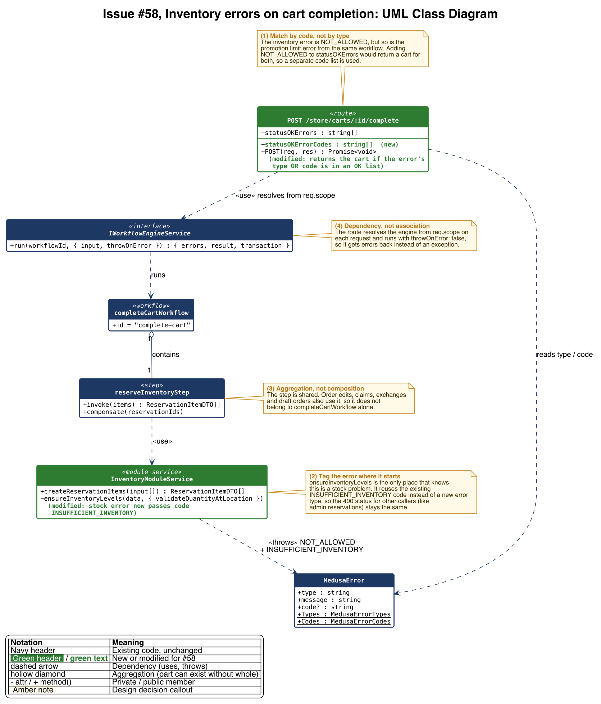
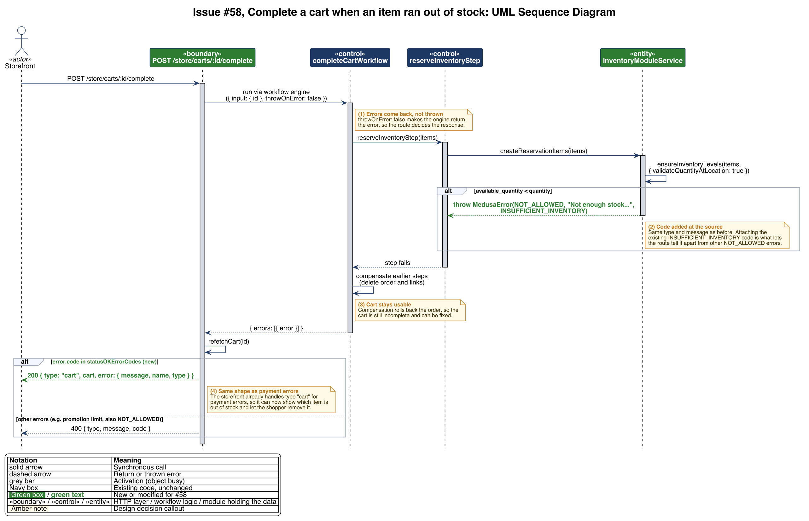

# Issue #58 -- Handle inventory errors distinctly when completing a cart

## Class Diagram

## Sequence Diagram

## Q&A

**Class diagram:**

1. Among all the classes shown in the diagram, which 1--2 are most central to understanding the codebase and solving the issue? Explain what role each one plays.

I'd say the complete cart route and InventoryModuleService. The route runs the workflow and decides what the storefront gets back if it fails. Before my change it only sent the cart back for payment errors and everything else was a 400. InventoryModuleService is where the out of stock error actually gets thrown, in ensureInventoryLevels when it reserves the stock. It took me a bit to find that one because I first thought the error came from confirm-inventory.ts, since that already uses the INSUFFICIENT_INVENTORY code, but that step doesn't even run when you complete a cart.

2. What is the most significant relationship shown in the diagram? Explain what it represents in the system and why it matters for understanding the solution.

The route depending on MedusaError to read the type and code. The route just gets an error object back from the workflow, so the type and code are basically all it has to go on when deciding between a 200 with the cart or a 400. The problem is the inventory error is NOT_ALLOWED, and so is the promotion limit error from the same workflow, so you can't tell them apart by type. That's why I added the code where the inventory error is thrown and then check for it in the route.

3. Looking back at your implementation, is there anything in this design you would change, and why?

Having two lists in the route, one for types and one for codes, is kind of awkward. If I did it again I'd probably put both checks in one small helper so whoever adds the next handled error only has one place to look. I'd also move refetchCart below the check, because right now it refetches the cart even for errors it's just going to rethrow. I didn't touch that since it was already there and not really part of the issue.

**Sequence diagram:**

1. What user action or system event starts the sequence, and what is the expected outcome when it completes successfully?

It starts when the shopper places their order and the storefront calls POST /store/carts/:id/complete, but one of the items sold out after they added it to the cart. What should happen is a 200 with type "cart", the cart and the error, which is the same thing payment errors already return. So the storefront can show which item is out of stock and let them remove it instead of just getting a 400.

2. Identify the 2--3 most important steps in the sequence. For each one, describe what is happening and note whether it involves existing code or new/modified code from your solution.

- ensureInventoryLevels sees there's less stock available than what's in the cart and throws a NOT_ALLOWED MedusaError. This one is modified. It already threw the error, I just added the INSUFFICIENT_INVENTORY code to it.
- The workflow rolls back the steps that already ran and hands the error back to the route instead of throwing, since the route runs it with throwOnError: false. This is all existing code, and it's the reason the cart is still usable after.
- The route checks the error's code against statusOKErrorCodes and sends back the cart with a 200. This is new. Before there was only the type list and NOT_ALLOWED wasn't in it.

3. What error cases or alternative paths are not shown in the diagram, and why did you leave them out?

I didn't show the normal successful order since nothing changed there, it just returns type "order". Same with the payment errors that already returned the cart. I also left out the other workflow steps like validating payment, creating the order and registering promotion usage, plus the error handler that turns rethrown errors into a 400. None of those were part of my change and the diagram got pretty hard to read with them in. The promotion limit case is just the "other errors" branch, but I kept it there since it's the main reason the check is by code and not type.

**Cross-cutting:**

4. If you used AI to create or check any part of the diagrams, describe what it produced, what you verified against the actual code, and what you had to correct or add. If AI was not used, write "N/A."

I used Claude Code to write the PlantUML for both diagrams off my #58 branch. I checked the classes, methods and steps against the code, mostly the complete route, reserve-inventory.ts, ensureInventoryLevels in inventory-module.ts and MedusaError. A couple labels were wrong at first. It said the rollback released the payment, but payment doesn't get authorized until after the inventory is reserved, so I changed that to deleting the order and links. It also called INSUFFICIENT_INVENTORY a new code when it already existed, so I reworded that note. The first versions also had way too much in them, like the error handler and the promotion step, so I cut them down to just what the issue actually touches.
