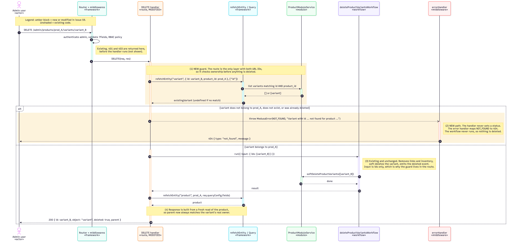

# Issue #59 -- Enforce product ID when deleting a product variant

## Class Diagram

Source: [59-njpiombino-class.mmd](59-njpiombino-class.mmd)

## Sequence Diagram

Source: [59-njpiombino-sequence.mmd](59-njpiombino-sequence.mmd)

## Q&A

**Class diagram:**

1. Among all the classes shown in the diagram, which 1--2 are most central to understanding the codebase and solving the issue? Explain what role each one plays.
- The route module's DELETE handler. It's the only place that has both IDs from the URL, and it's the only code that changed. It reads the params, runs the guard, calls the workflow, and builds the response.

2. What is the most significant relationship shown in the diagram? Explain what it represents in the system and why it matters for understanding the solution.
- The composition between Product and ProductVariant (one product has zero or more variants, linked by product_id). Variants can't exist without their product, and they are cascade-deleted with it. The bug was that the DELETE route ignored this ownership link and would return the incorrect product parent.

3. Looking back at your implementation, is there anything in this design you would change, and why?
- The product check only protects this one route. Any other code that calls deleteProductVariantsWorkflow directly can still delete a variant without checking its product parent.

**Sequence diagram:**

1. What user action or system event starts the sequence, and what is the expected outcome when it completes successfully?
- An admin sends DELETE /admin/products/:id/variants/:variant_id, for example by deleting a variant from the product page in the dashboard. When it succeeds, the response is 200 with deleted: true, the variant's own product as parent, the variant id, and object:"variant".

2. Identify the 2--3 most important steps in the sequence. For each one, describe what is happening and note whether it involves existing code or new/modified code from your solution.
- The guard lookup (new): the handler calls refetchEntity to find a variant matching both the variant ID and the product ID through Query to the product module.
- The 404 branch (new code, existing error handling): if nothing matches, the handler throws MedusaError NOT_FOUND.
- The workflow run (existing): deletes the product variant.

3. What error cases or alternative paths are not shown in the diagram, and why did you leave them out?
- Authentication (401) and role-check (403) failures, which happen in the router before the handler runs. Also not shown: a 400 for an invalid ?fields query, and the workflow failing partway, for example when the variant's inventory item has reservations makes deleteInventoryItemWorkflow throw "Cannot remove following inventory item(s) since they have reservations" and the earlier steps are rolled back.

**Cross-cutting:**

4. If you used AI to create or check any part of the diagrams, describe what it produced, what you verified against the actual code, and what you had to correct or add. If AI was not used, write "N/A."
- I used Claude Code to draft the Mermaid source for both diagrams. It checked the class relationships against the code. I then verified these and fixed one Mermaid syntax error. Otherwise, diagrams were produced well with no issues.
