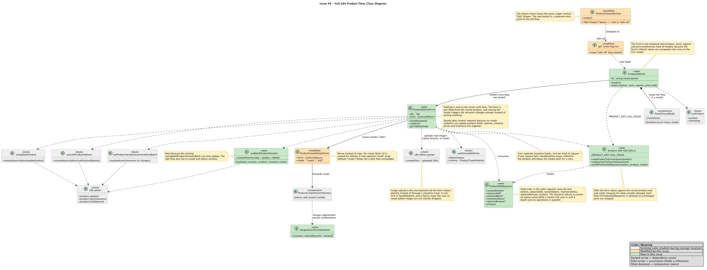
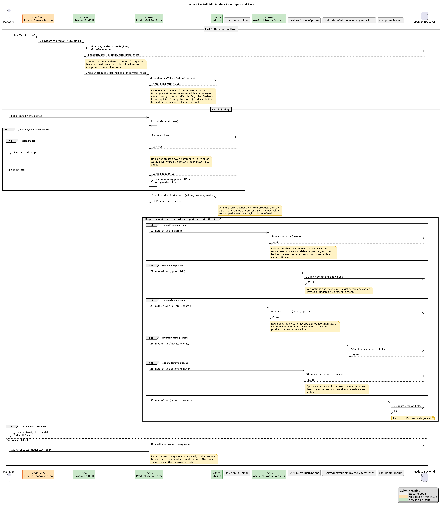

# Issue #8 -- Add Edit Product button to allow full product editing

## Class Diagram

## Sequence Diagram

## Q&A

**Class diagram:**

1. Among all the classes shown in the diagram, which 1--2 are most central to understanding the codebase and solving the issue? Explain what role each one plays.

   `ProductEditFullForm` is the most central class. It owns the multi-step form state (the current tab and the form values), pre-fills the form from the stored product, and holds the save handler (`handleSubmit`) that sends everything to the backend only when the manager confirms. Acceptance criteria 3, 5, 6 and 7 are all implemented here.

   `product-edit-full/utils.ts` is the second most important. `mapProductToFormValues` turns a stored product into form values (criterion 3). `buildProductEditRequests` compares the submitted form against the stored product and produces a `ProductEditRequests` object containing only what changed. Without it, the form would have no way to turn one "save everything" action into valid backend requests.

2. What is the most significant relationship shown in the diagram? Explain what it represents in the system and why it matters for understanding the solution.

   The most significant relationship is `ProductEditFullForm` reusing `ProductCreateDetailsForm` (and through it `ProductCreateVariantsSection`) with `mode="edit"`. It represents the decision to reuse the create-product UI for editing instead of copying it. This is how the flow "mirrors the create product flow in structure and step order" (criterion 2) and covers every field available during creation (criterion 4). The new optional `mode` prop defaults to `"create"`, so the existing create flow behaves exactly as before. The prop is what lets the shared builder handle edit-only rules, such as not removing an option that is already saved on the product.

3. Looking back at your implementation, is there anything in this design you would change, and why?

   Yes. `ProductEditFullForm` does too much: it is the form UI and also the orchestrator for an upload plus up to six ordered backend requests. I would move that sequence into its own hook or a single backend workflow. That would make the order easier to test and reduce the form component's size. A backend workflow could also roll back earlier steps on failure. Today the requests are sent one after another, so a failure partway through can leave earlier changes saved. The current code handles that by refetching the product and keeping the modal open, but a rollback would be stronger.

**Sequence diagram:**

1. What user action or system event starts the sequence, and what is the expected outcome when it completes successfully?

   The sequence starts when a store manager clicks the "Edit Product" button on the product detail page. This navigates to `products/:id/edit-all`, which loads the product and related data and shows the pre-filled multi-step form. After the manager edits fields and clicks Save on the last tab, all changes are saved, a success toast is shown, and the modal closes, returning them to the product detail page showing the updated values.

2. Identify the 2--3 most important steps in the sequence. For each one, describe what is happening and note whether it involves existing code or new/modified code from your solution.

   - **Building the requests (`buildProductEditRequests`), new code.** The form values are diffed against the stored product, and only changed parts are included. This is what makes the single "Save" correct and efficient, and it is where the request payloads are produced.
   - **Sending the requests in a fixed order, new code in `handleSubmit` using a mix of new and existing hooks.** Variant deletes go first, then new options, then variant creates and updates, then inventory kit changes, then option removals, and the product's own fields last. The order is required by backend rules (for example, an option value cannot be unlinked while a variant still uses it). The variant batch call uses the new `useBatchProductVariants` hook, while the option, inventory and product updates use existing hooks (`useLinkProductOptions`, `useProductVariantsInventoryItemsBatch`, `useUpdateProduct`).
   - **Loading everything before showing the form, new code (`ProductEditFull`) calling existing hooks.** The form is only rendered once the product, store, regions and price preferences have all loaded, because the form's default values are computed once on first render. Pre-filling via `mapProductToFormValues` depends on this.

3. What error cases or alternative paths are not shown in the diagram, and why did you leave them out?

   The diagram shows the image-upload failure and the "any request failed" path, but it leaves out several smaller cases to keep it readable:
   - Failures while loading the product, store, regions or price preferences. These are thrown to the route's error boundary, the same way the create flow does it.
   - Form validation errors on "Next", which block moving to the next tab and show the errors on the tab where they occur.
   - The manager closing the modal early, which triggers the unsaved-changes prompt and discards the form without sending anything (criterion 6). I only mention this in a note.
   - The inventory-kit tab, which only appears when at least one variant is a kit.
   - Cmd/Ctrl+Enter keyboard shortcuts.

   These either follow existing framework behavior or do not change how the save works, so showing them would add clutter without adding understanding.

**Cross-cutting:**

4. If you used AI to create or check any part of the diagrams, describe what it produced, what you verified against the actual code, and what you had to correct or add. If AI was not used, write "N/A."

   I used Claude Code to help create the diagrams. It read the PR #79 diff and produced the first drafts of the two PlantUML files, including the class boxes, relationships, annotations and color legend. It also explained basic UML notation and how to choose which relationships to draw. The AI checked, against the actual code, the structure of `handleSubmit` (the order of requests and the failure handling), the `ProductEditRequests` type and its ordering comment, the new hook `useBatchProductVariants`, the new `edit-all` route, and the button and `mode` prop changes. It also confirmed that `ProductCreateVariantsSection` calls `mergeVariantCombinations`. I reviewed the rendered diagrams, and the AI changed one class after I pointed out a disconnected `upload.create()` label: it became its own `sdk.admin.upload` class with a note. Some method and attribute names in the class boxes were simplified from the code, and the existing-code classes (such as the hooks and `sdk.admin`) show only the members relevant to this issue.
